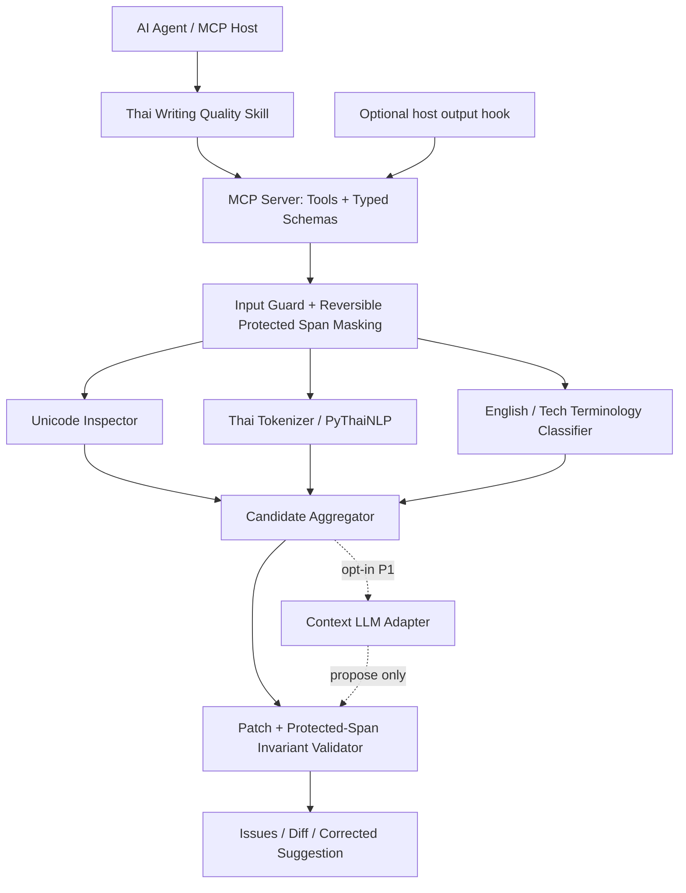

# Architecture — Thai-English Technical Writing MCP

## Overview

## Layering and boundaries
- **MCP adapter:** tool schemas, exceptions to structured errors, transport. No NLP business rules.
- **Core pipeline:** span discovery -> analysis views -> candidate issues -> patches -> invariant checks -> structured result. Pure functions wherever possible.
- **Protection engine:** lex Markdown fences/inline spans, URLs, paths, API routes, code identifiers, placeholders, timestamps, numeric expressions and user-specified project terms. Handle overlapping spans via priority; record exact positions in source.
- **Thai analyzer:** PyThaiNLP `word_tokenize(engine='newmm')` with read-only custom dictionary/Trie; dictionary candidate generation. Tokenization and spelling are distinct operations.
- **English analyzer:** allowlist + controlled typo suggestions; avoid blanket language classification based on ASCII alone. Unknown abbreviations default to review.
- **Terminology:** layered dictionaries global -> domain -> project -> request; explicit allow/protect/canonical/suggest rules. Project protection overrides automatic suggestions, unless the request explicitly authorizes editing.
- **Optional LLM adapter:** OpenAI-compatible endpoint; prompt isolates data, strict JSON suggestion schema; never apply directly, route through validator. Provider configured by env, disabled by default.
- **Quality gate:** check overlapping patches, positional integrity, replacement scope, protected content, numbers, schema and maximum edit ratio. Semantic equivalence cannot be guaranteed automatically: use abstention / human review for uncertain cases.

## Data flow
1. Input limits, JSON schema validation and request-scoped config.
2. Compute protected spans on **original code point offsets**; build analysis view with mapping.
3. Detect segments script by script but account for mixed technical phrases.
4. Run deterministic rules first; optionally generate spelling suggestions.
5. Merge issues, deduplicate, mark low-confidence edits as `requires_review`.
6. Optionally call LLM for contextual errors after an initial no-LLM baseline.
7. Sort patches, check non-overlap and original-span preconditions.
8. Verify invariants and emit structured issues + minimal diff. Never auto-apply semantic rewrite.

## MCP specification
Transport P0: stdio; P1: Streamable HTTP. MCP response should have machine-readable structured content and human-readable concise summary. Tool input schemas strongly typed; errors have stable codes `INVALID_INPUT`, `TOO_LARGE`, `RULE_FAILURE`, `PROTECTED_CONTENT_VIOLATION`, `LLM_UNAVAILABLE`.

## Suggested Python packages
`src/thai_writing_mcp/server.py` (MCP binding), `core/pipeline.py`, `core/protection.py`, `core/offsets.py`, `engines/unicode.py`, `engines/thai.py`, `engines/english.py`, `engines/llm_adapter.py`, `core/patches.py`, `core/validate.py`, `schemas/models.py`, `config/`, `tests/`.
Use Python >=3.11; lock a tested MCP SDK version (consult current SDK API), PyThaiNLP version and optional LLM client version. Keep transport separate from engine for deterministic unit tests.

## Deployment
Local `stdio` process is default, no network or persistence. Optional Docker HTTP service requires authentication, request size limits, timeouts, rate limits and loopback bind by default. API key via env/secret manager only. Multi-project glossary selection must be tenant-scoped.

## Observability
Counts by rule/profile, success/error, tokenization time, tool latency p50/p95, suggestion acceptance/rejection; no raw input storage by default. Record anonymized test corpus separately under explicit consent.

## Threat modeling
Untrusted input may contain prompt injection, Unicode confusables, bidirectional marks, secrets, very long single tokens, malformed JSON, accidental code-like spans and Markdown nesting. Implement deny-to-auto-correct for ambiguous / unparseable sections, deterministic upper bounds and safe logging.

## Dependency / evidence references
- Official MCP Python SDK: https://py.sdk.modelcontextprotocol.io/
- MCP specification: https://modelcontextprotocol.io/specification
- PyThaiNLP tokenize + custom dictionaries: https://pythainlp.org/dev-docs/api/tokenize.html
All runtime APIs must be verified against versions pinned by the implementing agent.
